# Modelling the rare-disease diagnostic odyssey from administrative claims

*Methods report. Every quantitative result below is marked with its provenance: `[METHOD]` for properties of the estimator, `[SYNTHETIC]` for numbers computed on simulated claims, `[LITERATURE]` for published external figures. No result here is a claim about real patients.*

## The problem in one paragraph

Patients with rare conditions are widely reported to wait years for a correct diagnosis. Administrative claims are the obvious data source for measuring this at scale -- they are longitudinal, population-sized and already collected. They are also structurally incapable of observing the quantity of interest. Claims record billing, so the earliest event they can contain is the first time a patient sought care *and someone coded something*; symptom onset leaves no trace. Every estimate of diagnostic delay from claims is therefore an estimate of a latent quantity through a proxy, under censoring, inside a database with finite history. This package builds that estimator, and then measures how far wrong it is by running it against simulated claims where the latent quantity is known.

## The panel

Six conditions chosen to disagree with each other along the axes that plausibly drive delay: tempo, presenting setting, mortality, and how specific the early symptoms are. `[LITERATURE]`

| Condition | ICD-10 | Published delay (yr) | Mean onset age | Death hazard /yr | Most common wrong label |
|---|---|---|---|---|---|
| ALS | G12.21 | 1.00 | 58.00 | 0.32 | cervical spondylosis with myelopathy |
| Gaucher type 1 | E75.22 | 4.00 | 21.00 | 0.01 | immune thrombocytopenic purpura |
| Late-onset Pompe | E74.02 | 8.00 | 35.00 | 0.02 | limb-girdle muscular dystrophy |
| Hereditary angioedema | D84.1 | 10.00 | 12.00 | 0.01 | allergic reaction / histaminergic angioedema |
| Hypermobile EDS | M35.7 | 12.00 | 14.00 | 0.00 | fibromyalgia |
| Fabry | E75.21 | 14.00 | 9.00 | 0.01 | growing pains / idiopathic limb pain |

The published delays are *inputs*, not findings: they set the ground truth the simulator generates from. One friction scalar per disease is fitted by bisection so the simulated true median delay matches its anchor. Because the target is the true delay rather than anything the pipeline estimates, calibration cannot flatter the estimators.

## Study designs

`[METHOD]` Two designs are implemented because the literature is split between them and they do not agree.

**Diagnosed-anchored (retrospective).** Identify patients who carry the diagnosis, then look backwards for the first sustained symptom signature. Optimistic for two compounding reasons: the never-diagnosed are absent from the denominator, and a delay longer than the available history cannot be represented.

**Suspicion-anchored (prospective).** Enter the cohort on a symptom signature, follow forward to diagnosis or censoring. Not conditioned on the outcome, but contaminated by phenocopies -- people with fibromyalgia who do not have hypermobile EDS enter the hEDS risk set and dilute the curve.

Neither is correct. Reported together they bracket the answer.

`[SYNTHETIC]` Cohort sizes:

| Condition | Design | n | Diagnosed | Censored | Died undiagnosed | % left-truncated |
|---|---|---|---|---|---|---|
| ALS | suspicion | 459 | 106 | 285 | 68 | 34.9 |
| ALS | diagnosed | 48 | 48 | 0 | 0 | 0.0 |
| Gaucher type 1 | suspicion | 280 | 168 | 102 | 10 | 43.6 |
| Gaucher type 1 | diagnosed | 75 | 75 | 0 | 0 | 16.0 |
| Late-onset Pompe | suspicion | 469 | 151 | 242 | 76 | 43.9 |
| Late-onset Pompe | diagnosed | 61 | 61 | 0 | 0 | 27.9 |
| Hereditary angioedema | suspicion | 564 | 154 | 401 | 9 | 60.3 |
| Hereditary angioedema | diagnosed | 62 | 62 | 0 | 0 | 53.2 |
| Hypermobile EDS | suspicion | 3,853 | 164 | 3,564 | 125 | 26.7 |
| Hypermobile EDS | diagnosed | 63 | 63 | 0 | 0 | 65.1 |
| Fabry | suspicion | 1,012 | 139 | 847 | 26 | 50.8 |
| Fabry | diagnosed | 53 | 53 | 0 | 0 | 62.3 |

## Does the case definition find the right people?

`[SYNTHETIC]` The simulator emits rule-out coding -- specialists who code a rare disease as a hypothesis and move on, and controls who pick up a spurious code during a workup -- so the phenotype algorithm is graded on an exam that has wrong answers.

| Condition | Flagged | True cases | PPV | Sensitivity |
|---|---|---|---|---|
| ALS | 149 | 1,200 | 0.980 | 0.122 |
| Gaucher type 1 | 252 | 1,200 | 0.988 | 0.207 |
| Late-onset Pompe | 202 | 1,200 | 0.995 | 0.168 |
| Hereditary angioedema | 238 | 1,200 | 0.987 | 0.196 |
| Hypermobile EDS | 238 | 1,200 | 0.966 | 0.192 |
| Fabry | 188 | 1,200 | 0.995 | 0.156 |

Sensitivity is low across the board (median 0.18), and that is the correct behaviour rather than a defect: most simulated patients are diagnosed outside their coverage window, or not at all within it. A case definition cannot find a diagnosis that was never billed. It is precision that matters for a delay study, since a false positive contributes an entirely fictitious odyssey.

## How late is the origin?

`[SYNTHETIC]` The claims-based origin -- first sustained symptom signature -- against true symptom onset. The error is one-sided by construction: the proxy can never precede the first claim.

| Condition | n | Median lateness (yr) | p25 | p75 | vs first care contact (yr) |
|---|---|---|---|---|---|
| ALS | 48 | 0.38 | 0.29 | 0.56 | -0.00 |
| Gaucher type 1 | 75 | 0.65 | 0.32 | 1.04 | -0.00 |
| Late-onset Pompe | 61 | 1.56 | 0.70 | 2.71 | -0.00 |
| Hereditary angioedema | 62 | 1.04 | 0.28 | 6.98 | 0.58 |
| Hypermobile EDS | 60 | 4.35 | 1.22 | 8.77 | 2.97 |
| Fabry | 53 | 3.50 | 0.90 | 11.84 | 2.76 |

`[SYNTHETIC]` Part of that lateness is a phase claims cannot see at all: symptom onset to first care contact. No claim is generated while a patient is unwell and has not presented, so this interval is absent from administrative data rather than merely noisy. It is the irreducible floor on what any claims-only study can observe.

| Condition | n | Median (yr) | p25 | p75 |
|---|---|---|---|---|
| ALS | 1,200 | 0.36 | 0.26 | 0.53 |
| Gaucher type 1 | 1,200 | 0.64 | 0.40 | 1.03 |
| Late-onset Pompe | 1,200 | 1.17 | 0.67 | 2.02 |
| Hereditary angioedema | 1,200 | 0.31 | 0.23 | 0.43 |
| Hypermobile EDS | 1,200 | 1.56 | 0.85 | 2.82 |
| Fabry | 1,200 | 1.01 | 0.59 | 1.71 |

## Estimate versus truth

`[SYNTHETIC]` The retrospective estimate against ground truth, with the bias split into the part caused by *who gets analysed* (selection) and the part caused by *where the clock starts* (measurement).

| Condition | True (yr) | Estimated (yr) | Selection (yr) | Measurement (yr) | Understated by |
|---|---|---|---|---|---|
| ALS | 1.19 | 0.87 | 0.14 | -0.45 | 0.27 |
| Gaucher type 1 | 4.01 | 3.55 | 0.09 | -0.55 | 0.11 |
| Late-onset Pompe | 8.12 | 5.09 | -1.58 | -1.45 | 0.37 |
| Hereditary angioedema | 10.00 | 6.20 | -0.69 | -3.11 | 0.38 |
| Hypermobile EDS | 12.14 | 7.32 | 1.97 | -6.79 | 0.40 |
| Fabry | 12.93 | 6.18 | 1.86 | -8.61 | 0.52 |

`[SYNTHETIC]` Across the panel: r = 0.96 (Spearman rho 0.83) between estimated and true median delay, mean absolute bias 3.20 years, mean understatement 34%.

The split is the useful part. Median selection component 0.12 years; median measurement component -2.28 years. Selection is fixable by design -- follow a suspicion cohort forward instead of conditioning on the outcome. Measurement is not fixable by design at all, because it is a property of the data source. The only remedies are a longer look-back or an onset date from outside the claims.

### How many patients does this need?

`[SYNTHETIC]` Most simulated cases never reach the analysable cohort -- they are diagnosed outside their coverage window, or not at all within it -- so 1,000 simulated cases per disease yields only 50-90 usable odysseys each. On the same seed, correlation between estimated and true median delay rises from r=0.81 at 400 cases per disease to r=0.98 at 1,000. Below roughly 60 analysable patients the per-disease median is dominated by sampling noise rather than by any property of the method.  The practical reading: a published delay estimate for a single rare disease, drawn from a cohort of a few dozen patients, is not precise enough to compare against another disease or another era, however carefully it was computed. Ranking a panel of diseases is a far more robust use of the same data than quoting any one of their delays.

**The ranking survives even though the levels do not.** A rank correlation near 1 with a large negative bias means claims can tell you reliably *which* rare diseases have the worst odysseys while being systematically wrong about *how bad* any of them are. For prioritising where to intervene that is often enough; for quoting a number in a policy document it is not.

## The look-back ceiling

`[SYNTHETIC]` The retrospective analysis re-run on progressively truncated claims histories. Estimated median delay in years:

| History (yr) | ALS | Gaucher type 1 | Late-onset Pompe | Hereditary angioedema | Hypermobile EDS | Fabry |
|---|---|---|---|---|---|---|
| 3.0 | 1.4 | 2.3 | 2.1 | 2.5 | 2.2 | 2.5 |
| 5.0 | 1.7 | 2.8 | 3.7 | 4.6 | 4.6 | 4.1 |
| 8.0 | 0.9 | 2.8 | 2.7 | 5.3 | 5.2 | 5.5 |
| 11.0 | 0.8 | 4.5 | 3.9 | 5.9 | 6.3 | 6.8 |
| 14.0 | 0.9 | 3.6 | 4.8 | 6.2 | 6.3 | 6.5 |
| 16.0 | 0.9 | 3.5 | 5.1 | 6.2 | 7.3 | 6.2 |

`[METHOD]` A database holding *W* years of history cannot exhibit a delay longer than *W*. The estimate does not become noisy as *W* shrinks -- it saturates just below *W*, for every disease simultaneously. Two studies of the same condition in databases of different vintage will therefore disagree, with the shorter database reporting the shorter delay. Presented as a time series, that artefact is indistinguishable from an improvement in care.

## Where the years go

`[SYNTHETIC]` Share of observed pre-diagnosis time by pathway phase, from the occupancy integral of the fitted multi-state model.

| Condition | Undifferentiated care | Non-diagnostic specialist | Carrying a wrong label | At the right specialty |
|---|---|---|---|---|
| ALS | 0.784 | 0.088 | 0.001 | 0.127 |
| Gaucher type 1 | 0.270 | 0.025 | 0.669 | 0.036 |
| Late-onset Pompe | 0.417 | 0.052 | 0.460 | 0.071 |
| Hereditary angioedema | 0.409 | 0.069 | 0.490 | 0.031 |
| Hypermobile EDS | 0.346 | 0.020 | 0.627 | 0.006 |
| Fabry | 0.356 | 0.072 | 0.552 | 0.020 |

The phases are inferred from provider specialty and from the persistence of differential-diagnosis codes, not from anything the simulator labelled. `[METHOD]`

`[SYNTHETIC]` Weibull sojourn shape in the *carrying a wrong label* state has a panel median of 0.81. A shape below 1 means the exit hazard falls the longer the label has held: each additional year makes revision less likely, not more. That is what a settled misdiagnosis looks like quantitatively, and it is why a wrong label costs more delay than the visits it generates would suggest.

## Death is not censoring

`[METHOD]` For a condition with substantial pre-diagnosis mortality, `1 - Kaplan-Meier` answers "what fraction would eventually be diagnosed if nobody died". Nobody asked that. The Aalen-Johansen cumulative incidence answers the question actually posed, and the gap between them is the amount by which the naive curve extrapolates the diagnosis hazard over person-time that does not exist.

`[SYNTHETIC]` ALS: peak overstatement 2.0 percentage points (7% relative) at 3.5 years; cumulative incidence of dying undiagnosed reaches 20.6%.
`[SYNTHETIC]` Late-onset Pompe: peak overstatement 11.4 percentage points (22% relative) at 7.1 years; cumulative incidence of dying undiagnosed reaches 27.2%.

**The correction is larger for Pompe than for ALS, and that inverts the intuition.** ALS has by far the higher mortality, but it kills fast enough that most patients who die undiagnosed never accumulate a symptom signature and so never enter the cohort. Mortality did its selecting upstream of the estimator, where no competing-risk method can reach it. A small Aalen-Johansen correction is therefore not evidence that death did not matter -- it can equally mean death mattered so much that those patients are missing from the denominator entirely. `[METHOD]`

## What would need to be true for these estimates to be usable

`[METHOD]` Three conditions, in decreasing order of how easy they are to satisfy:

1. **History longer than the delay.** If the plausible delay is a decade, a decade of continuous enrolment is the minimum, and enrolment churn means a database needs far more than a decade of coverage to yield a usable sample of such patients.
2. **An outcome-independent risk set.** Enter patients on symptoms, not on the diagnosis, and accept the contamination -- it is measurable, whereas the selection bias it replaces is not.
3. **An external onset date for a validation subset.** Nothing inside the claims can calibrate the measurement error. A linked registry, chart review or patient survey on even a few hundred patients would pin the one term this design cannot estimate from its own data.

## Status

The pipeline is validated end to end on the simulator. It has **not** been run on real claims: MarketScan, Optum and the Medicare LDS are all licensed, and the one public alternative -- CMS DE-SynPUF -- is unsuitable on four independent grounds documented in `rdd/adapters/synpuf.py` (three-year history, Medicare age range, per-variable synthesis that breaks longitudinal coherence, and no provider specialty). The adapters exist so that the analysis runs unchanged the moment real data is available.

All recovery quality gates pass. They are enforced as tests, so a change that quietly breaks recovery fails CI rather than producing a slightly different plot nobody checks.

*Generated from 12,090 simulated patients and 641,552 claim lines. Source: simulator v0.1 seed=20260813 n=13200.*

## Figures

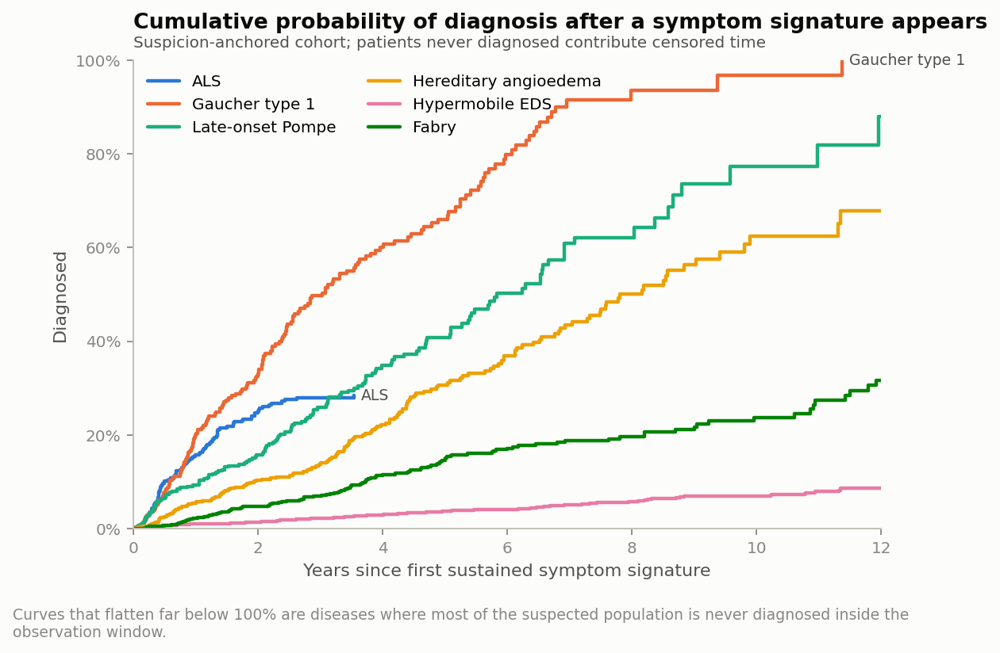

*Cumulative probability of diagnosis, prospective design.*

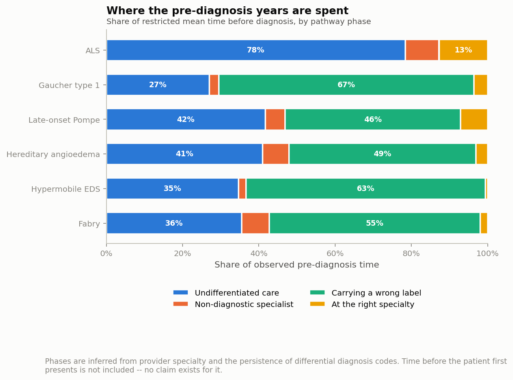

*Share of pre-diagnosis time by pathway phase.*

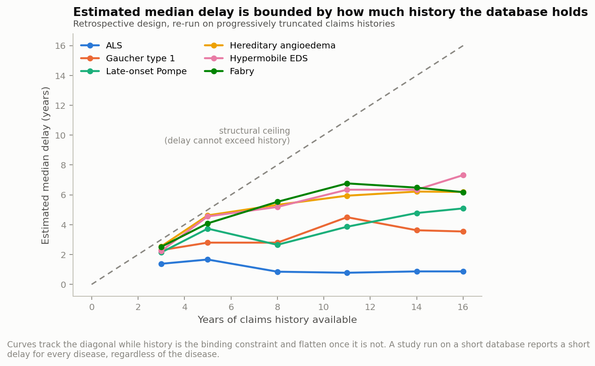

*Estimated delay against available database history.*

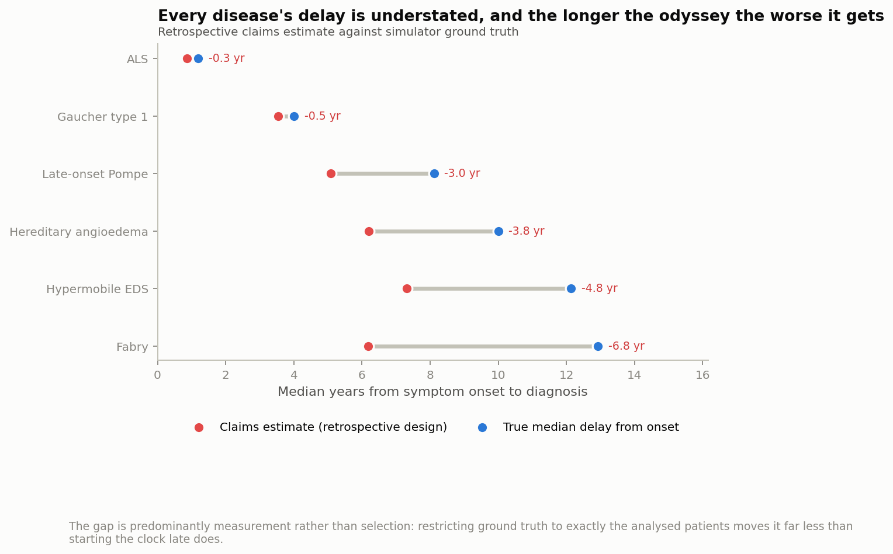

*Claims estimate against ground truth.*

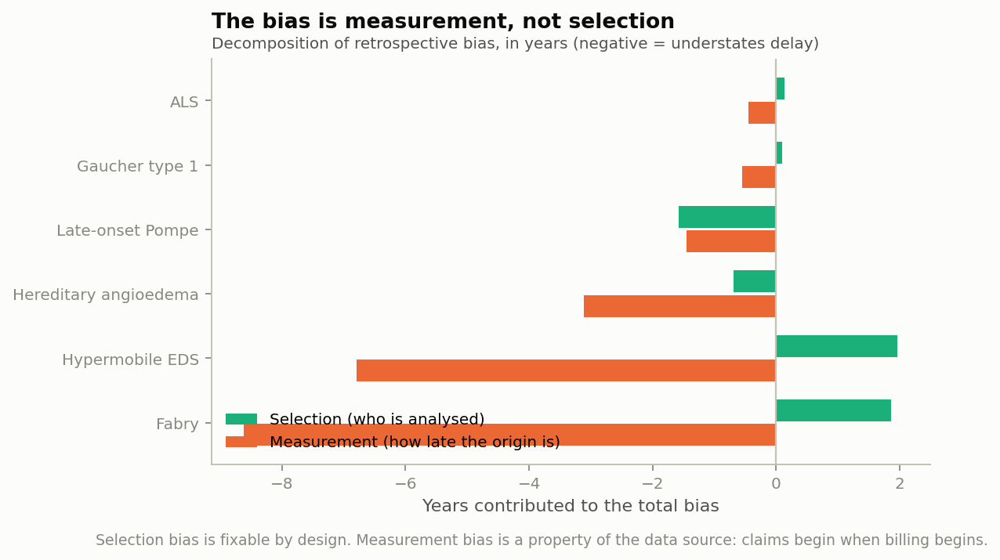

*Bias split into selection and measurement.*

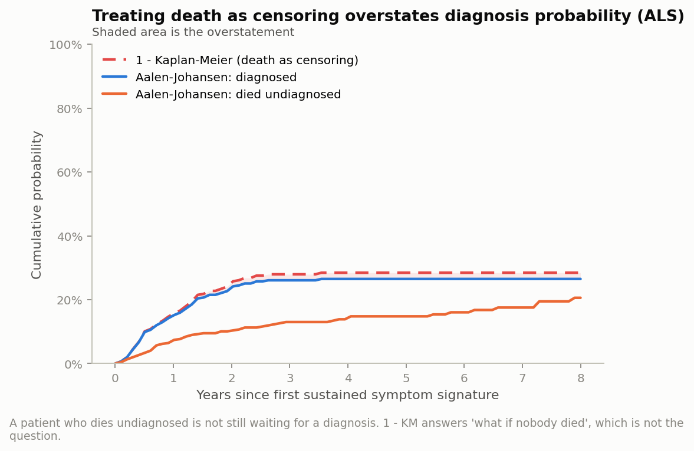

*Competing risks in ALS.*

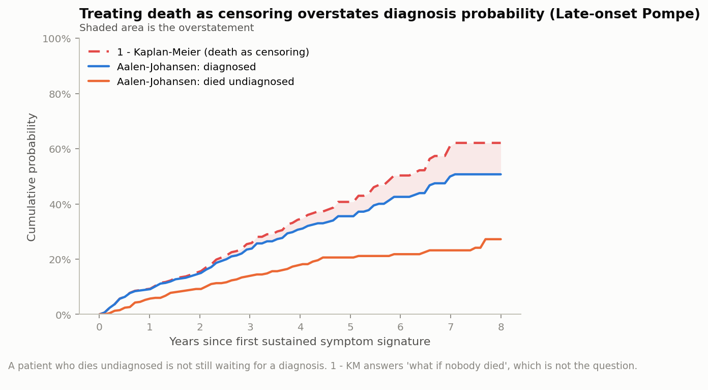

*Competing risks in late-onset Pompe.*

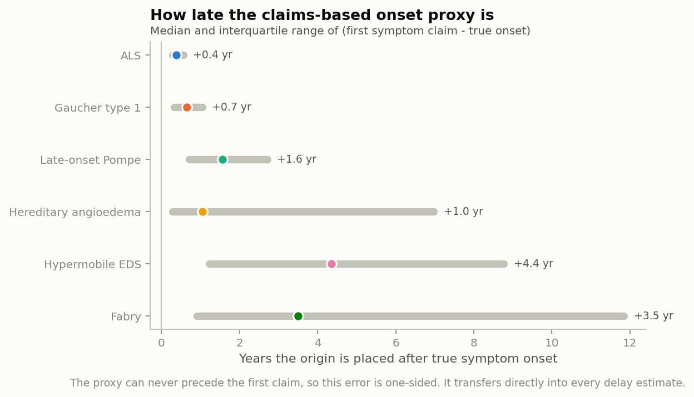

*Lateness of the claims-based origin.*

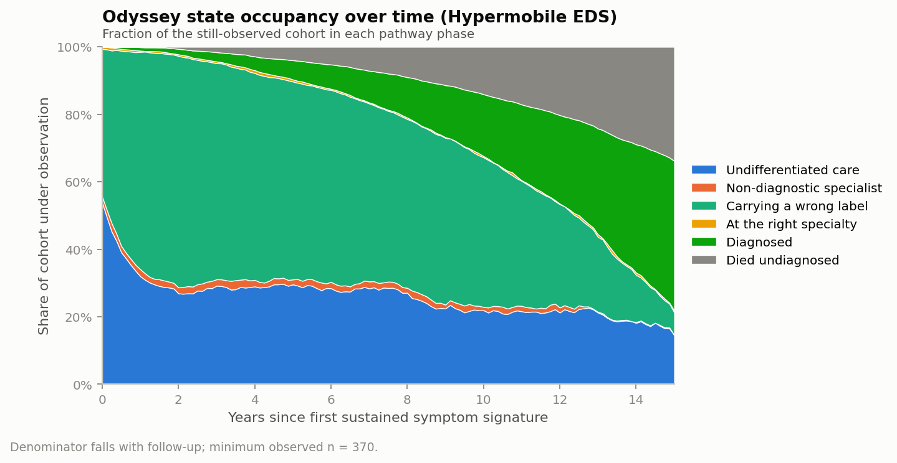

*State occupancy over the odyssey (hEDS).*

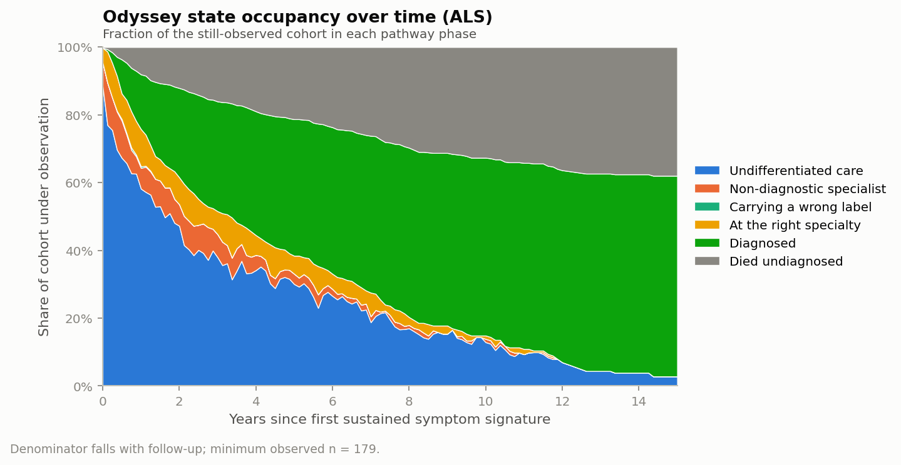

*State occupancy over the odyssey (ALS).*

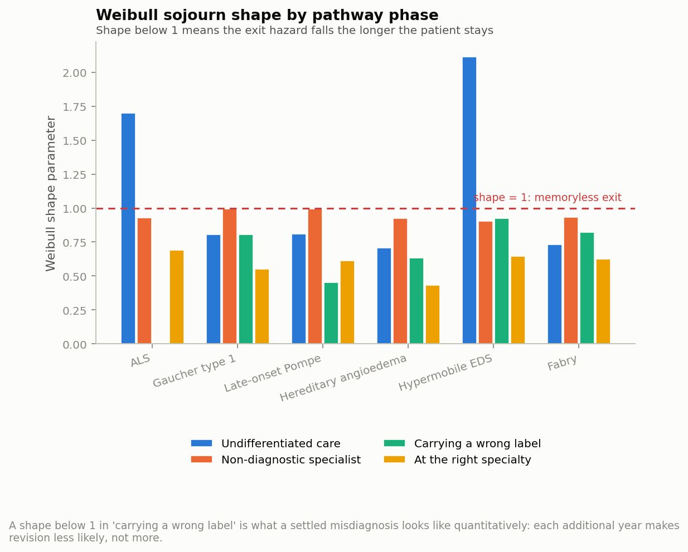

*Weibull sojourn shape by phase.*
